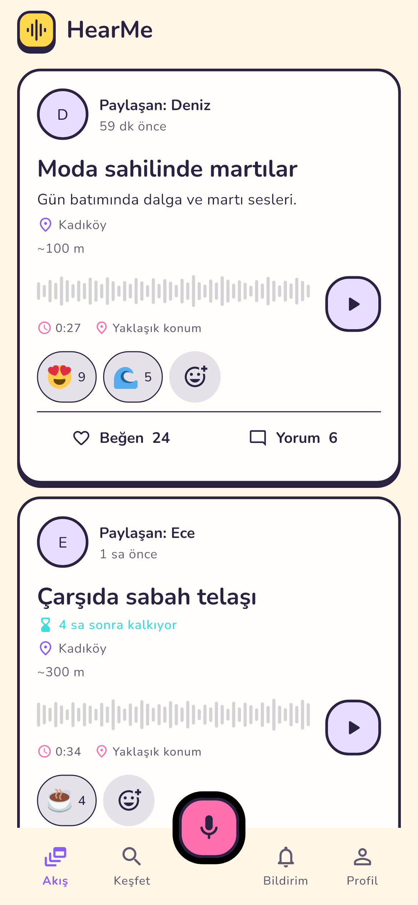
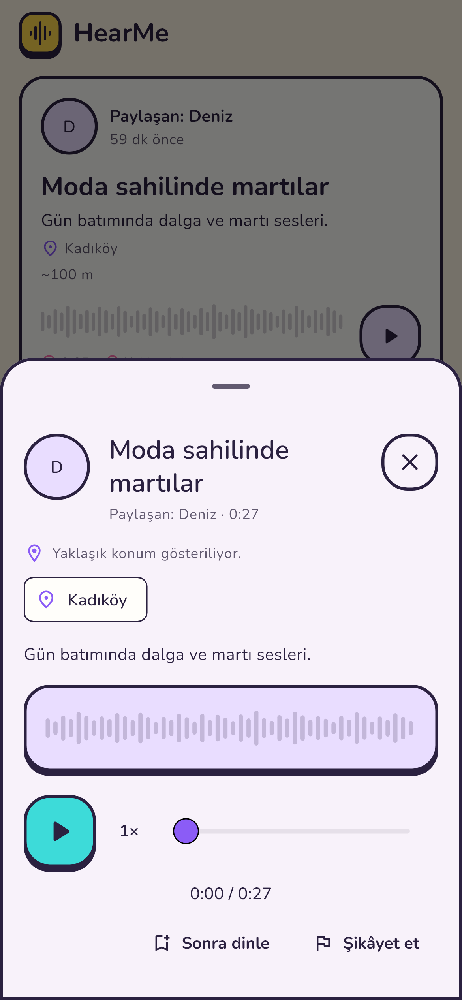
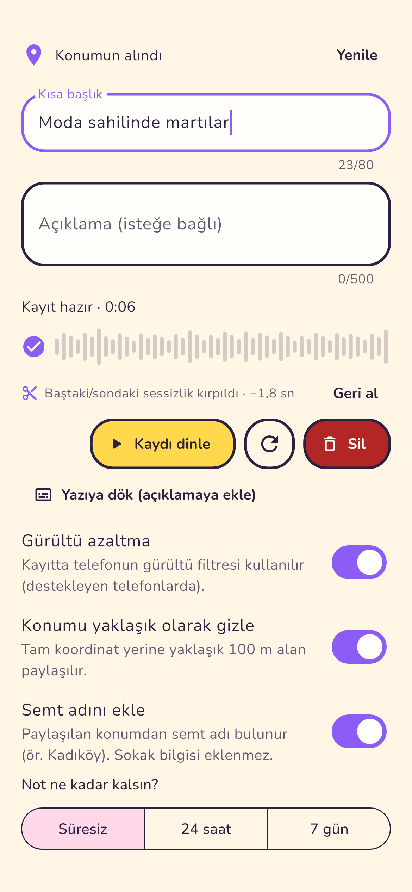
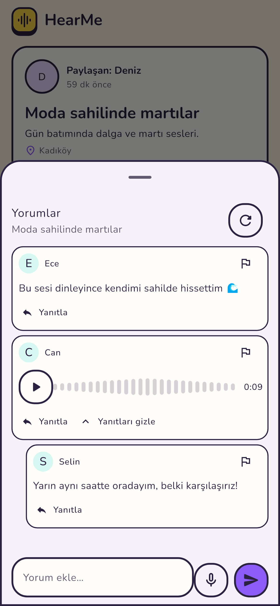
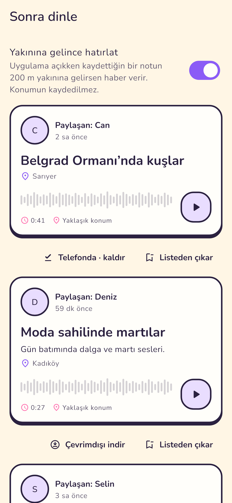
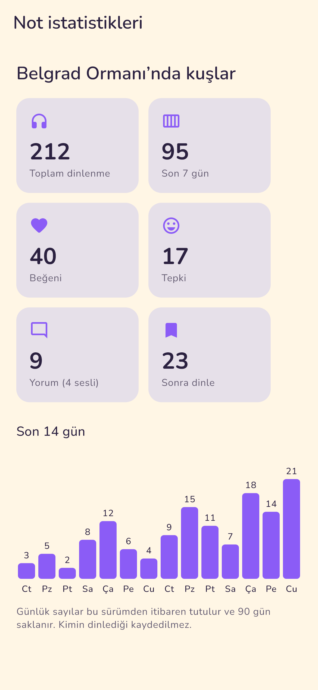

  

<h1 align="center">HearMe</h1>

  <b>Sesini bulunduğun yere bırak, çevrendekileri dinle.</b> 
  <i>Leave your voice where you are, listen to the places around you.</i>

  <a href="https://github.com/MuratAcar00/HearMe-Releases/releases/latest/download/HearMe-arm64.apk"><b>⬇️ Android APK indir · Download</b></a>
  &nbsp;·&nbsp;
  <a href="https://github.com/MuratAcar00/HearMe-Releases/releases/latest">Sürüm notları · Release notes</a>

  <a href="#türkçe">Türkçe</a> · <a href="#english">English</a>

<table align="center">
  <tr>
    <td align="center"></td>
    <td align="center"></td>
    <td align="center"></td>
  </tr>
  <tr>
    <td align="center"><b>Yakındakiler</b> Nearby notes</td>
    <td align="center"><b>Dinle</b> Listen</td>
    <td align="center"><b>Kaydet ve paylaş</b> Record & share</td>
  </tr>
  <tr>
    <td align="center"></td>
    <td align="center"></td>
    <td align="center"></td>
  </tr>
  <tr>
    <td align="center"><b>Sesli yorumlar</b> Voice comments</td>
    <td align="center"><b>Sonra dinle</b> Listen later, offline</td>
    <td align="center"><b>Not istatistikleri</b> Note stats</td>
  </tr>
</table>

Görsellerdeki kişiler ve notlar örnektir. · People and notes in the images are examples.

---

## Türkçe

HearMe, kısa sesli notları bulunduğun yere bırakmanı ve çevrendeki sesleri keşfetmeni sağlayan bir uygulama. Bir sahildeki martılar, bir çarşının sabah telaşı, bir sokak müzisyeni: yerin sesi orada kalır, oradan geçen dinler.

### Neler yapabilirsin

- 🎙️ **Basılı tut ve kaydet.** Baştaki ve sondaki sessizlik kendiliğinden kırpılır, telefonun gürültü filtresi devrede. Paylaşmadan önce kaydını dinleyebilirsin.
- 📝 **Yazıya dök.** Kaydını telefonun kendi konuşma tanımasıyla açıklamaya yazdır, sonra düzenle.
- 📍 **Yakındakiler ve harita.** Çevrendeki notları listede ya da haritada gör, semt adına dokunup o semtteki notlara geç.
- ▶️ **Rahat dinleme.** 1×, 1,5× ve 2× hız. Telefon kilitliyken de çalmaya devam eder, kilit ekranından duraklatırsın.
- 🔖 **Sonra dinle.** Notları kaydet, istersen telefona indirip bağlantı yokken dinle. Kaydettiğin bir notun yakınına gelince uygulama haber verir.
- 💬 **Sesli yorumlar ve tepkiler.** Bir nota ya da yoruma sesle cevap ver, emojiyle tepki bırak.
- ⏳ **Süreli notlar.** Notun 24 saat ya da 7 gün sonra kendiliğinden kalksın.
- 📊 **İstatistikler.** Kendi notunun kaç kez dinlendiğini ve son 14 günü gör. Kimin dinlediği tutulmaz.
- 👥 **Gruplar.** Yalnız grup üyelerinin görebildiği notlar paylaş.

### Gizlilik

- Konumunu istersen yaklaşık (~100 m) paylaşırsın; semt adı sokak bilgisi içermez.
- Yakınlık hatırlatması yalnız uygulama açıkken çalışır; konumun kaydedilmez.
- Yazıya dökme telefonunda yapılır, ses bu iş için sunucuya gönderilmez.
- Verilerini dışa aktarabilir, hesabını uygulamadan silebilirsin.

### Kurulum (Android)

1. [En son APK'yı indir](https://github.com/MuratAcar00/HearMe-Releases/releases/latest/download/HearMe-arm64.apk) (64 bit ARM telefonlar).
2. Telefon izin isterse bu kaynaktan kurulumu onayla.
3. Uygulama yeni sürümleri kendisi bildirir; güncelleme mevcut kurulumun üzerine yapılır, verilerin silinmez.

Her sürümde APK'nın SHA-256 değeri `.sha256` dosyasında ve `update.json` içinde yayımlanır.

---

## English

HearMe lets you leave short voice notes where you are and discover the sounds around you. Gulls on a seafront, a market waking up, a street musician: the sound stays at the place, and whoever passes by can listen.

### What you can do

- 🎙️ **Hold to record.** Leading and trailing silence is trimmed automatically and the phone's noise filter is on. Listen back before you share.
- 📝 **Transcribe.** Turn your recording into the description with the phone's own speech recognition, then edit it.
- 📍 **Nearby and map.** See notes around you in a list or on a map; tap a district name to see that district's notes.
- ▶️ **Comfortable listening.** 1×, 1.5× and 2× speed. Playback continues with the screen locked, with lock-screen controls.
- 🔖 **Listen later.** Save notes, download them to listen offline, and get a reminder when you are near one you saved.
- 💬 **Voice comments and reactions.** Reply to a note or a comment by voice, or react with an emoji.
- ⏳ **Expiring notes.** Let a note disappear after 24 hours or 7 days.
- 📊 **Stats.** See how often your note was played over the last 14 days. Who listened is never stored.
- 👥 **Groups.** Share notes only members of your group can see.

### Privacy

- You can share an approximate location (~100 m); district names never include street details.
- The nearby reminder only works while the app is open; your location is not stored.
- Transcription runs on your phone; the audio is not sent to a server for it.
- You can export your data and delete your account from within the app.

### Install (Android)

1. [Download the latest APK](https://github.com/MuratAcar00/HearMe-Releases/releases/latest/download/HearMe-arm64.apk) (64-bit ARM phones).
2. If your phone asks, allow installing from this source.
3. The app tells you about new versions itself; updates install over the current app and keep your data.

Each release publishes the APK's SHA-256 in the `.sha256` file and in `update.json`.

---

Bu depo yalnız Android sürümlerini ve güncelleme bilgisini barındırır; uygulamanın kaynak kodu gizlidir. This repository only hosts Android releases and update metadata; the application source remains private.

